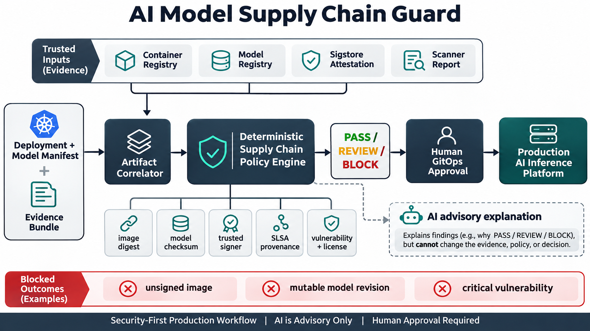

# AI Model Supply Chain Guard

A deterministic GitOps release gate that verifies the container image, model artifact, signer identity, SLSA provenance, vulnerability evidence, and license policy as one production decision.



## Production problem

An AI inference release is not one artifact. It combines a serving image, model weights, configuration, and evidence produced by multiple systems. Pinning the container image does not prevent a mutable model revision from changing. A valid signature does not prove that provenance matches the deployed digest or that current vulnerability policy passes.

The guard correlates those facts before merge while keeping AI outside the enforcement boundary. Demand evidence and primary sources are in [`docs/research.md`](docs/research.md).

## What it checks

- Container images are pinned by SHA-256 digest.
- Model artifacts carry a SHA-256 checksum and immutable revision.
- Image signatures verify and match a trusted workload identity.
- SLSA provenance is verified, uses an approved builder, matches the image digest, and names a full source commit.
- Model attestations match the exact model digest.
- Vulnerability evidence is fresh and within critical/high thresholds.
- Detected licenses do not violate policy.
- Decisions are deterministic: `PASS`, `REVIEW`, or `BLOCK`.

AI is advisory only. It can explain evidence or draft a remediation plan, but cannot alter evidence, trust roots, vulnerability thresholds, policy, approvals, or deployments.

## Quick start

```bash
python -m venv .venv
source .venv/bin/activate
pip install -e . pytest
pytest
model-supply-chain-guard samples/compliant-bundle.json \
  --now 2026-11-05T14:00:00Z \
  --output json
```

The compliant sample returns 100 and `PASS`.

## Architecture and workflow

1. CI produces a release manifest for the image and model.
2. Trusted verification adapters normalize registry, Sigstore, provenance, and scanner evidence.
3. The correlator binds evidence to the exact artifact digests.
4. The deterministic policy engine evaluates trust, provenance, freshness, vulnerabilities, and licenses.
5. Optional AI explains the result without enforcement authority.
6. Human GitOps approval is required before production deployment.

## Validation

The 15-test suite covers compliant evidence plus mutable images and models, missing checksums, unverified or untrusted signers, missing SLSA provenance, untrusted builders, digest mismatches, weak source revisions, model attestation mismatch, stale scans, vulnerability thresholds, and denied licenses. GitHub Actions runs all tests and replays the compliant sample with a fixed evaluation time.

## Safe deployment

Start report-only, independently verify every source artifact, protect trust policy, retain evidence, and enforce the same digest-bound decision at admission time. The reference implementation does not call a registry or cluster; production adapters must perform real cryptographic verification. See [`docs/deployment.md`](docs/deployment.md).

## Measurable outcomes

Track digest-pinning coverage, verified provenance coverage, evidence age, exception count and age, false positives, remediation time, mismatched-evidence blocks, and artifact traceability during incidents.

## Trade-offs

- Strict evidence requirements reduce supply-chain risk but can block releases during registry or transparency-log outages.
- Keyless identities reduce long-lived key management but require careful issuer and subject policy.
- Fresh scans improve confidence but add pipeline time and do not eliminate unknown vulnerabilities.
- Immutable model revisions strengthen reproducibility but require deliberate model promotion and rollback workflows.
- Static policy validates evidence structure; runtime model safety and behavioral evaluation remain separate responsibilities.

## Interview positioning

This project demonstrates secure CI/CD, Kubernetes release controls, Sigstore and in-toto concepts, SLSA provenance, model artifact governance, deterministic policy-as-code, test design, failure-mode analysis, and secure AI boundaries. The strongest interview story is recognizing that model and container provenance must be evaluated together, then designing a reproducible gate that keeps final authority with humans.

## License

MIT
