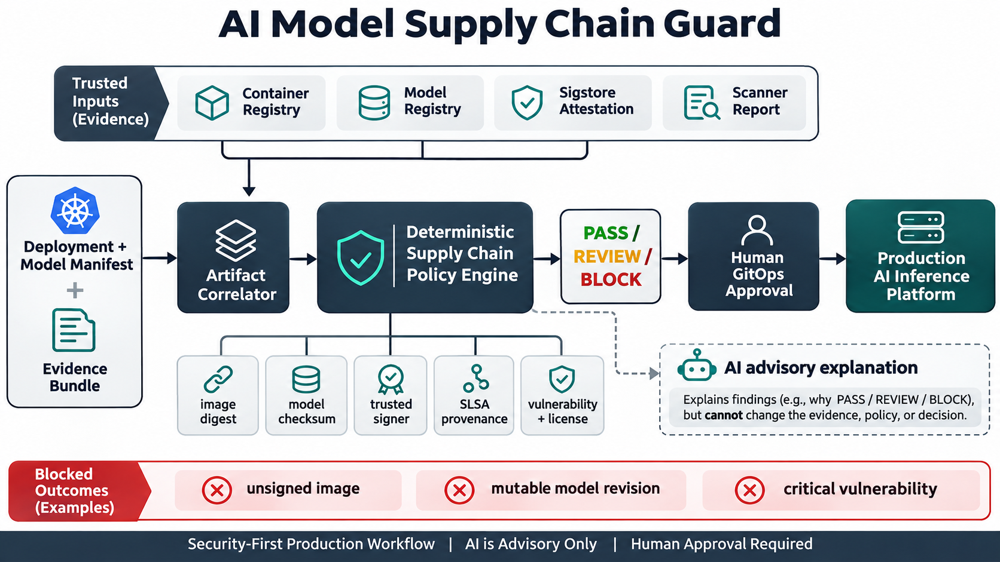

# Verifying the Model and Container as One AI Release

Imagine an incident responder confirms that a production container image is signed, only to discover that the service downloaded a mutable model revision whose source, checksum, and builder cannot be reconstructed.

This is organizationally important because AI releases combine more than application code. They include model weights, registries, build workflows, scanner results, signing identities, and deployment manifests. Weak evidence increases the cost of incident containment, audit response, rollback, and customer assurance.

The security problem is fragmented trust. A signature may be valid for the wrong digest. Provenance may come from an unapproved builder. A scan may be stale. A model URI may point to `latest` even when the serving image is immutable.

I built **AI Model Supply Chain Guard**, a deterministic GitOps gate that binds the container and model evidence into one release decision.

- It requires the serving image and model to be identified by immutable SHA-256 evidence rather than mutable tags or revisions.
- It verifies signer identity, SLSA provenance, trusted builder, source commit, and exact image digest correlation.
- It requires a model attestation that matches the exact model checksum selected for the release.
- It enforces scanner freshness, critical and high vulnerability thresholds, and denied-license policy.
- It emits reproducible `PASS`, `REVIEW`, or `BLOCK` evidence while AI remains advisory and human GitOps approval remains mandatory.

## Why this is in demand now

Current AI-infrastructure security roles explicitly combine Kubernetes admission, artifact signing, provenance, scanning, model-serving infrastructure, and policy automation. Kubernetes itself recommends digest-pinned images, Sigstore supports signature and in-toto attestation verification, and SLSA defines provenance for reconstructing where, when, and how artifacts were produced.

## Implementation and validation

The Python engine evaluates a normalized release evidence bundle against versioned JSON policy. The 15-test suite covers mutable references, signature and builder trust, provenance and attestation mismatches, stale scans, vulnerabilities, and licenses. CI uses a fixed evaluation timestamp so evidence-age decisions are reproducible.

## Deployment, security, and reliability

The reference implementation deliberately does not trust itself to perform registry access. Production adapters must independently verify Cosign bundles, attestations, and scanner evidence before normalization. I would introduce the gate report-only, protect trust policy, retain reports, and enforce the same digest-bound evidence with an admission controller. Registry or transparency-log outages need an auditable retry path rather than a silent bypass.

## Measurable outcomes and trade-offs

Useful measures include digest-pinning coverage, verified-provenance coverage, evidence age, exception age, false positives, remediation time, blocked mismatches, and artifact reconstruction time during incidents. Strict policy improves traceability but can slow releases. Keyless signing reduces key management but makes issuer and subject policy critical. Scanning improves confidence without proving behavioral model safety.

## Interview positioning

The core design decision is to treat the container and model as one release unit. That creates a strong discussion about CI/CD trust, Sigstore, SLSA, immutable model promotion, policy-as-code, failure modes, and why AI explanation must not alter security evidence or approve production changes.

Repository: https://github.com/ohjeffkuston/ai-model-supply-chain-guard

This is game-changing because it turns an opaque AI deployment into a traceable set of artifacts, identities, and verifiable production evidence.

Could your team reconstruct the exact source, builder, signer, model checksum, and scan result for every AI workload running today?
